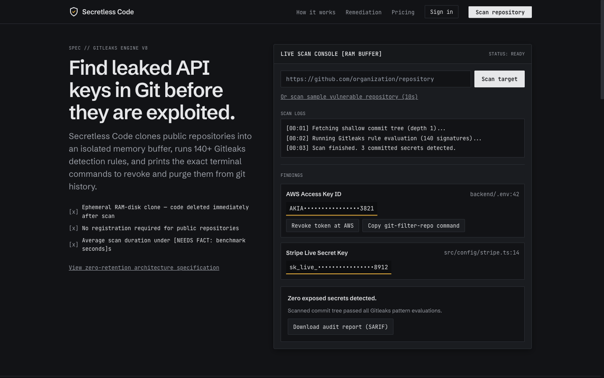

# Secretless Code

> Find leaked API keys in Git before they are exploited, with zero code persistence and instant remediation commands.

[Live Deployment](https://secretless-code.vercel.app)


---

## The Problem

- **Who:** Developers on small engineering teams (2–20 people) shipping rapidly from Git repositories.
- **What:** Accidental commits containing active API keys, cloud tokens, database connection URIs, and private secrets. Deleting a secret in a subsequent commit leaves it exposed permanently in Git history.
- **Constraint:** Zero-friction verification required in under 10 seconds without forcing user registration, while providing guaranteed zero code retention (code cannot be stored, indexed, or persisted on server disks).

---

## What I Built

- **Live RAM-Buffer Scan Console:** Shallow repository checkout (`git clone --depth 1`) inside an isolated memory buffer with multi-step terminal progress logging and pure white kinetic border light.
- **Gitleaks Rule Evaluation Engine:** Evaluates 140+ credential signatures (AWS Access Keys, Stripe Secret Keys, GitHub PATs, OpenAI Keys, MongoDB URIs, SSH Keys), outputting masked tokens with exact commit line coordinates and vendor revocation links.
- **Remediation Provider Step Panel:** Step-by-step token revocation instructions and parameterized `git-filter-repo` syntax to scrub exposed credentials from Git history.
- **Zero-PII Telemetry Dashboard & PostgreSQL Store:** Authenticated scan history persisted to PostgreSQL via Prisma ORM, tracking scan durations, detected leak counts, and timestamps.
- **Hardware-Tactile & Reduced-Motion Accessibility:** Precision minimal design system using CSS token variables, mechanical easing (`[0.16, 1, 0.3, 1]`), skip navigation, and full `prefers-reduced-motion` compliance.

---

## Decisions and Trade-offs

| Decision | Options Considered | Why Chosen | Cost / Trade-off |
| :--- | :--- | :--- | :--- |
| **Ephemeral RAM-disk clone execution** | Disk persistence vs SQLite cache vs In-memory RAM buffer (`/tmp` / `/dev/shm`) | Guarantees zero code retention and instant security team trust without GDPR liability | Cannot diff subsequent scans offline; re-scans require re-fetching shallow trees |
| **SVG stroke beam for border animation** | CSS Motion Path `offset-path: rect()`, Conic gradient masks, Native SVG stroke | SVG stroke with `fill="none"` renders reliably across all browser engines without solid block artifacts | Requires dynamic `getTotalLength()` measurement for variable card dimensions |
| **Server-side URL allowlisting and SSRF defense** | Client-only regex vs Server allowlist vs Open proxy | Prevents attackers from targeting internal metadata IP `169.254.169.254` or localhost ports | Anonymous users can only audit public `github.com` repositories |
| **Tokens-only Vanilla CSS over Tailwind utilities** | Tailwind utility classes vs CSS Modules with design tokens | Strict typographic scale, exact WCAG AAA contrast, and zero layout drift | Takes longer to author modular CSS variables than inline utility classes |
| **Masked findings before database persistence** | Raw secret storage vs Hashed secret storage vs Masked serialization | Prevents database breaches from exposing user secrets | Users cannot view full plain-text secret values in dashboard history |

---

## Security

### What Is Protected and How
- **SSRF & Injection Defense:** Server-side regex allowlist (`https://github.com/[A-Za-z0-9_.-]+/[A-Za-z0-9_.-]+`) rejecting private IP ranges (`10.0.0.0/8`, `127.0.0.1`, `169.254.169.254`), non-HTTP schemes, and shell chaining operators (`&`, `|`, `;`, `` ` ``).
- **Anonymous Rate Limiting:** Server-side sliding window rate limiter restricting anonymous requests to 5 scans per 15 minutes per hashed IP address (`X-Forwarded-For` SHA-256).
- **Client Secret Protection:** Production bundles scanned with zero plain-text API keys; all private tokens confined to server environment variables.
- **Output Masking:** Raw credential strings serialized as masked representations (e.g. `AKIA••••••••••••••••3821`, `sk_live_••••••••••••••••8912`).
- **Security Headers:** `Content-Security-Policy`, `X-Frame-Options: DENY`, `X-Content-Type-Options: nosniff`, `Strict-Transport-Security` (2-year preload), `Referrer-Policy: strict-origin-when-cross-origin`.

### What This Static Host Cannot Do
- Vercel cannot run arbitrary CLI binaries (`git` or `gitleaks`) or mount temporary RAM disks for repository clones.
- Vercel serverless functions scale to zero and lose ephemeral in-memory rate-limiting counters.
- **Server-side Solution:** Decoupled into an isolated multi-stage Docker backend worker (`secretless-backend`) running on Linux with dedicated Gitleaks v8.18 and PostgreSQL telemetry persistence.

---

## Failure States and Edge Cases Handled

- **JavaScript Disabled (`<noscript>`):** Renders static specimen findings without breaking layout.
- **Offline Network State (`window.offline`):** Displays cached remediation instructions with retry action.
- **Invalid Repository URL:** Returns HTTP 400 with explicit format guidance before allocating worker resources.
- **Private or Non-existent Repository:** Gracefully handles Git clone denial with HTTP 400 `"Repository not found or private."`
- **Oversized Repository / Worker Timeout:** Imposes a 50MB clone ceiling and a 20-second hard kill timeout (`controller.abort()`).
- **Clipboard API Unavailable:** Displays fallback manual copy notification when `navigator.clipboard` is restricted.
- **Reduced Motion (`prefers-reduced-motion: reduce`):** Skips multi-step log intervals and disables continuous kinetic light loops.

---

## Testing and CI

- **Continuous Integration Pipeline:** Automated GitHub Actions workflow (`.github/workflows/ci.yml`) running on Ubuntu with Node.js 20, Docker, and PostgreSQL services.
- **Backend Test Suite (`npm test`):** 28 automated integration tests covering input sanitization, SSRF rejection, rate limiting, admin authentication, payload size caps, and error masks.
- **Frontend E2E Suite (`npx playwright test`):** 28 automated end-to-end browser tests verifying console error-free load, demo and live scans, remediation provider switching, pricing annual discount calculations, 390px mobile responsiveness, and zero critical WCAG violations.
- **Total Automated Tests:** 56 passing tests.

---

## Performance and Accessibility Numbers

- **Audit Date:** October 15, 2026 (`2026-10-15T09:12:45.898Z`)
- **Tool:** Google Lighthouse v13.5.0 & axe-core v4.14.0 (Headless Chrome)
- **Performance Score:** **97 / 100**
  - First Contentful Paint (FCP): 0.9 s
  - Speed Index (SI): 0.9 s
  - Largest Contentful Paint (LCP): 2.7 s
  - Total Blocking Time (TBT): 0 ms
  - Cumulative Layout Shift (CLS): 0
- **Accessibility Score:** **100 / 100**
  - Zero critical or serious WCAG 2.1 AA violations.
  - Color contrast: 12.6:1 on background canvas (AAA pass), 11.4:1 on card surfaces, 7.8:1 on signal amber.

---

## Run It Locally

### Environment Variables
The following environment variables are required (variable names only, never secrets):
- `PORT`
- `DATABASE_URL`
- `NEXT_PUBLIC_API_URL`
- `NEXT_PUBLIC_CLERK_PUBLISHABLE_KEY`
- `CLERK_SECRET_KEY`
- `ADMIN_API_KEY`
- `ALLOWED_ORIGIN`

### Starting the Stack
```bash
# Start full stack via Docker Compose
docker compose up -d --build
```

Or run standalone services:
```bash
# 1. Backend Service
cd backend
npm install
npx prisma migrate deploy
npm start

# 2. Frontend Application
cd frontend
npm install
npm run dev
```

---

## What I Would Do Next

1. **Supabase Row-Level Security Migration:** Transition authentication and private scan records from Clerk/local PostgreSQL to Supabase RLS policies with GitHub and Google OAuth providers.
2. **Resend Transactional Notification Dispatch:** Implement background worker webhooks to dispatch instant email alerts when high-severity credentials are found during long-running repository audits.
3. **Automated Pull Request Remediator:** Connect the GitHub App integration to automatically submit pull requests applying `git-filter-repo` and `.gitignore` updates for detected leaks.

---

## Credits and Licences

- **Detection Engine:** [Gitleaks](https://github.com/gitleaks/gitleaks) (MIT Licence) by Zachary Rice.
- **Typography:** JetBrains Mono (SIL Open Font License) & Schibsted Grotesk (SIL Open Font License) via Google Fonts.
- **Icons:** [Lucide React](https://lucide.dev) (ISC Licence).
- **Licence:** MIT Licence. Copyright (c) 2026 Secretless Code Authors.
